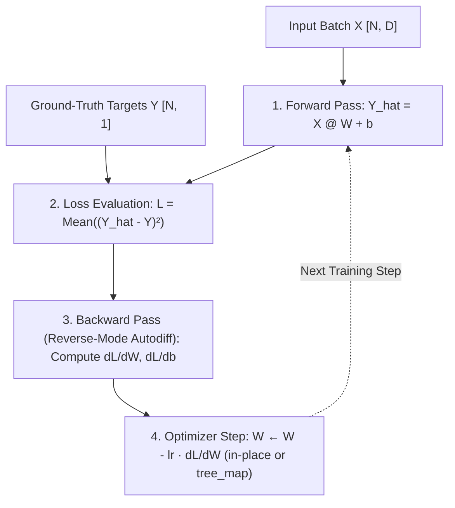

# Unit 0.2: Training Loop Mechanics — PyTorch Autograd vs. JAX `value_and_grad`

## 1. Learning Objectives & Production Context

By the end of this unit, you will be able to:
1. Derive and implement the 4 stages of supervised model training from scratch: **Forward Pass**, **Loss Evaluation**, **Backward Pass (Reverse-Mode Automatic Differentiation)**, and **Gradient Descent Update**.
2. Explain how PyTorch's **dynamic Autograd computation graph** (`requires_grad=True`, `grad_fn`, `loss.backward()`, `param.grad`) operates under the hood and why `zero_grad()` and `torch.no_grad()` are mandatory.
3. Explain how JAX's **functional automatic differentiation** (`jax.grad`, `jax.value_and_grad`, and `jax.tree_util.tree_map`) computes gradients without mutating state.
4. Train an identical multivariate linear regression model ($Y = XW + b$) in both **TorchTPU** and **JAX** and verify both converge to the exact same ground-truth parameters.

## 2. First-Principles Math & Mental Model: The 4-Step Training Loop

Every deep learning workload—from a 4-parameter linear regression model to a 400-billion-parameter Transformer—is an iterative optimization loop over four steps:



### Detailed Breakdown of Each Step

1. **Step 1: Forward Pass ($\hat{Y} = XW + b$)**
   Given an input batch $X$ of shape `[N, D]` ($N$ examples, $D$ features per example), weights $W$ of shape `[D, 1]`, and bias $b$ of shape `[1]`, the model predicts:
   $$\hat{Y}_i = \sum_{j=1}^{D} X_{i,j} W_j + b$$
2. **Step 2: Loss Computation ($L$)**
   The **Loss Function** measures how wrong the predictions $\hat{Y}$ are compared to the ground-truth targets $Y$, producing a **single scalar float**. For regression, we use **Mean Squared Error (MSE)**:
   $$L(W, b) = \frac{1}{N} \sum_{i=1}^{N} (\hat{Y}_i - Y_i)^2$$
3. **Step 3: Backward Pass (Reverse-Mode Automatic Differentiation / Backpropagation)**
   We want to know how a tiny change in each weight $W_j$ affects the scalar loss $L$. By the calculus chain rule:
   $$\frac{\partial L}{\partial W} = \frac{2}{N} X^T (\hat{Y} - Y), \qquad \frac{\partial L}{\partial b} = \frac{2}{N} \sum_{i=1}^{N} (\hat{Y}_i - Y_i)$$
   You do **not** write these derivative formulas by hand. Both PyTorch (**Autograd**) and JAX (**Autodiff**) apply the chain rule automatically to your forward-pass Python code.
4. **Step 4: Parameter Update (Stochastic Gradient Descent)**
   Because the gradient $\nabla_W L = \frac{\partial L}{\partial W}$ points in the direction of **steepest loss increase**, we subtract a fraction $\eta$ (**learning rate**) of the gradient from the weights to **decrease** the loss:
   $$W \leftarrow W - \eta \cdot \frac{\partial L}{\partial W}, \qquad b \leftarrow b - \eta \cdot \frac{\partial L}{\partial b}$$

## 3. Deep Comparison: PyTorch Autograd Tape vs. JAX Functional `value_and_grad`

While both frameworks compute the exact same mathematical derivatives, their execution mechanics are fundamentally different:

| Mechanism | PyTorch (`torch` / `torch_tpu`) | JAX (`jax`) |
| :--- | :--- | :--- |
| **How parameters are marked** | Tensors have a boolean flag `requires_grad=True` (or are wrapped in `torch.nn.Parameter`). | Parameters are ordinary `jax.Array` values stored in a nested Python dict/list/tuple (**PyTree**), passed as the first argument (`argnums=0`) to `loss_fn(params, x, y)`. |
| **How forward operations are tracked** | **Dynamic Tape**: Every operation on a tensor with `requires_grad=True` creates an output tensor with a `.grad_fn` pointer linking back to its parent inputs (`AddBackward0`, `MmBackward0`). | **Function Transformation**: `jax.value_and_grad(loss_fn)` traces `loss_fn` symbolically and synthesizes a new function that computes both the forward value and the reverse-mode cotangents. |
| **Where gradients are stored** | **Stateful Attribute**: `loss.backward()` walks the `.grad_fn` graph in reverse and accumulates (`+=`) gradients into each leaf tensor's `.grad` attribute (`W.grad`, `b.grad`). | **Pure Return Value**: `loss_val, grads = grad_fn(params, x, y)` returns `grads` as a brand-new dictionary (`grads["W"]`, `grads["b"]`) matching the structure of `params`. |
| **How parameters are updated** | In-place mutation inside `with torch.no_grad():` (or `optimizer.step()`), followed by `optimizer.zero_grad(set_to_none=True)`. | Functional construction of a new parameter PyTree via `params = jax.tree_util.tree_map(lambda p, g: p - lr * g, params, grads)`. |

### Concrete Code Comparison

#### PyTorch (`torch_tpu`) Training Step
```python
# Forward pass (builds dynamic autograd graph attached to 'loss')
y_pred = x @ w + b
loss = ((y_pred - y_true) ** 2).mean()

# Backward pass (populates w.grad and b.grad via += accumulation)
loss.backward()

# Parameter update (disable autograd tracking during weight mutation!)
with torch.no_grad():
    w -= lr * w.grad
    b -= lr * b.grad

# Mandatory reset so next step does not accumulate into old gradients
w.grad = None
b.grad = None
```

#### JAX (`@jax.jit` + `jax.value_and_grad`) Training Step
```python
def mse_loss(params, x, y_true):
    y_pred = x @ params["w"] + params["b"]
    return jnp.mean((y_pred - y_true) ** 2)

@jax.jit
def train_step(params, x, y_true, lr):
    # Evaluates mse_loss AND its derivatives w.r.t. arg 0 ('params')
    loss_val, grads = jax.value_and_grad(mse_loss)(params, x, y_true)
    # Apply update across every leaf array in the params dictionary
    new_params = jax.tree_util.tree_map(lambda p, g: p - lr * g, params, grads)
    return new_params, loss_val
```

## 4. Sharp Bits: Three Classic Autograd & Autodiff Bugs

### Bug 1: Forgetting `w.grad = None` (or `optimizer.zero_grad()`) in PyTorch
Because PyTorch executes `w.grad += new_grad` during `loss.backward()`, forgetting to clear `.grad` causes Step 2 to apply `grad_1 + grad_2`, Step 3 to apply `grad_1 + grad_2 + grad_3`, turning gradient descent into an unstable momentum explosion.
* **Best Practice**: Always use `optimizer.zero_grad(set_to_none=True)` or `param.grad = None`. Setting `.grad = None` instead of filling it with zeros avoids an unnecessary memset operation on TPU HBM.

### Bug 2: Updating PyTorch Weights Without `with torch.no_grad():`
If you write `w = w - lr * w.grad` without `torch.no_grad()`, two things break:
1. `w` is reassigned to a *non-leaf* tensor whose `.grad` attribute will not be populated on the next `loss.backward()`.
2. If you write `w -= lr * w.grad` in-place on a leaf variable with `requires_grad=True` outside `torch.no_grad()`, PyTorch raises:
   `RuntimeError: a leaf Variable that requires grad is being used in an in-place operation.`

### Bug 3: Calling `.item()` or `float(loss)` Inside a `@jax.jit` Function
Inside a function decorated with `@jax.jit`, all array values are **abstract tracers** (`ShapedArray(float32[])`) whose concrete numerical values are not known until the compiled XLA executable runs on the TPU. Attempting `float(loss)` or `if loss > 1.0:` inside `@jax.jit` raises `ConcretizationTypeError`. Return `loss` from the `@jax.jit` function first, then print it on the host.

## 5. Guided Hands-On Lab (`labs/lab_02_linear_regression_tpu_jax.py`)

Inspect `labs/lab_02_linear_regression_tpu_jax.py` in the right-hand code editor:
1. It generates a synthetic dataset $Y = X W_{\text{true}} + b_{\text{true}}$ with $N=256$ samples and 3 input features where $W_{\text{true}} = [2.5, -1.5, 4.0]^T$ and $b_{\text{true}} = 0.75$.
2. Before running the loop, it verifies **analytical gradient parity**: on Step 0, it prints the exact gradient tensor $\nabla_W L$ computed by PyTorch `loss.backward()`, JAX `jax.value_and_grad`, and the closed-form calculus formula $\frac{2}{N} X^T (\hat{Y} - Y)$, showing all three match to machine precision ($\sim 10^{-7}$).
3. It runs 50 steps of gradient descent in both PyTorch and JAX and verifies that both recover $W = [2.5, -1.5, 4.0]^T$ and $b = 0.75$.

### Run & Experiment
1. Click **Run Code** to execute `labs/lab_02_linear_regression_tpu_jax.py`.
2. Verify that Step 0 gradients match across Analytical Calculus, PyTorch Autograd, and JAX Autodiff, and that both models converge to MSE Loss `< 1e-5`.
