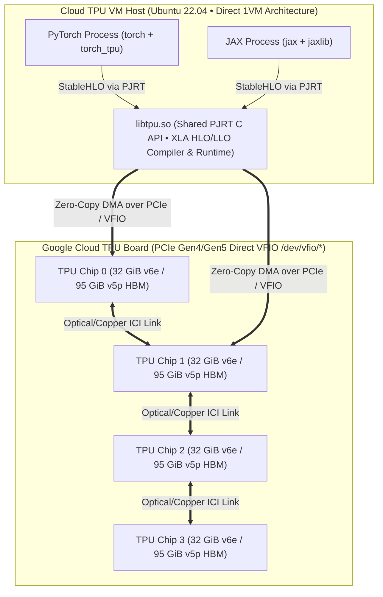

# Unit 0.3: Cloud TPU VM Architecture, Topologies & Spot Provisioning

## 1. Learning Objectives & Production Context

By the end of this unit, you will be able to:
1. Explain the **Cloud TPU VM (1VM)** direct-attach architecture vs. legacy 2VM gRPC proxy nodes.
2. Decode GCP TPU accelerator topology names (`v6e-1`, `v6e-4`, `v6e-8`, `v5p-8`, `v5litepod-4`) in terms of **physical chips**, **TensorCores per chip**, **HBM capacity**, **Inter-Chip Interconnect (ICI)** topology, and **VM host count**.
3. Provision a **Spot Cloud TPU VM** in `torchtpu-learning-lab` using Cloud TPU Queued Resources and install open-source `torch_tpu==0.2.0` from PyPI alongside `jax[tpu]` (or build custom wheels from source via Bazel).

## 2. Cloud TPU VM (1VM) Architecture

Historically (TPU v2/v3 prior to 2021), Cloud TPUs used a "2VM" split architecture where users logged into a standard GCE VM and sent XLA programs over gRPC to a separate, inaccessible TPU host.

Modern Cloud TPUs (**TPU v4, v5e, v5p, and v6e Trillium**) exclusively use the **Cloud TPU VM (1VM)** architecture:
* When you provision a TPU VM, you receive **direct SSH access to the physical Linux host machine** whose PCIe root complex is wired directly to the TPU boards.
* Your Python process (`python3`) loads the shared library **`libtpu.so`** into its address space.
* Both **JAX** (`jaxlib` PJRT client) and **TorchTPU** (`torch_tpu` PJRT client) talk to the exact same `libtpu.so` C API (`PJRT` — Plug-in PJRT Runtime) to compile StableHLO graphs and drive the TPU hardware via kernel driver `/dev/accel*` or `/dev/vfio/*`.



### Important Operational Consequence: Single-Process Hardware Lock
Because `libtpu.so` maps the TPU PCIe VFIO device files directly into the process memory space for zero-copy DMA, **only one OS process can hold the TPU device lock on a given chip at a time**.
* If Process A is holding `/dev/vfio/0` (for example, an idle Python REPL or background zombie training script), Process B will fail on startup with `RESOURCE_EXHAUSTED: Accelerator device is busy`.
* Our lab runner executes each script in a clean, short-lived process that releases the TPU lock immediately upon completion.

## 3. Decoding TPU Generations & Topologies (`v6e` Trillium vs. `v5p` vs. `v5e`)

| Spec / Metric | TPU v6e (Trillium) | TPU v5p | TPU v5e (`v5litepod`) |
| :--- | :--- | :--- | :--- |
| **Target Workload** | High-efficiency training & low-latency LLM serving | Massive-scale frontier LLM training | Cost-optimized medium training & inference |
| **TensorCores per Chip** | **1 TensorCore** per chip | **2 TensorCores** per chip (MegaCore fused) | **1 TensorCore** per chip |
| **MXU Systolic Array Size** | **$256 \times 256$** (2 MXUs / chip) | **$128 \times 128$** (4 MXUs / core, 8 / chip) | **$128 \times 128$** (4 MXUs / chip) |
| **Peak `bf16` TFLOPs / Chip** | **918 TFLOPs** | **459 TFLOPs** | **197 TFLOPs** |
| **HBM Capacity / Chip** | **32 GB** | **95 GB** | **16 GB** |
| **HBM Bandwidth / Chip** | **1,640 GB/s** | **2,765 GB/s** | **820 GB/s** |
| **Single-Host Topologies** | `v6e-1` (1 chip), `v6e-4` (4 chips, $2\times 2$), `v6e-8` (8 chips, $2\times 4$) | `v5p-8` (4 chips / 8 cores, $2\times 2\times 1$) | `v5litepod-1` (1 chip), `v5litepod-4` (4 chips, $2\times 2$), `v5litepod-8` (8 chips, $2\times 4$) |
| **GCP Runtime Version** | `v2-alpha-tpuv6e` | `v2-alpha-tpuv5` | `v2-alpha-tpuv5-lite` |

### Why `v5p-8` Has 4 Logical Devices (`device_count() == 4`)
Notice the naming difference between `v5p` and `v6e`:
* On **TPU v5p**, each physical silicon die contains **2 TensorCores**. GCP names `v5p` slices by **TensorCore count** (`v5p-8` = 8 TensorCores = 4 physical chips on 1 VM). By default, `libtpu` runs in **MegaCore** mode, which binds the 2 TensorCores on each chip together so they share the chip's 95 GB HBM as a single logical device (380 GB total HBM on `v5p-8`). Therefore, both `torch.accelerator.device_count()` and `jax.device_count()` return **`4`** on a `v5p-8` VM.
* On **TPU v6e (Trillium)**, Google redesigned the chip around **1 giant TensorCore** with two $256 \times 256$ MXUs and 32 GB HBM. Therefore, `v6e-<N>` names the **exact number of physical chips** (`v6e-1` = 1 chip, `v6e-4` = 4 chips, `v6e-8` = 8 chips).

## 4. Provisioning & Open-Source `torch_tpu` Installation in `torchtpu-learning-lab`

With the open-source release of **`torch_tpu` (`https://github.com/google-tpu/torch_tpu`)**, official pre-built `manylinux_2_28_x86_64` wheels for Python 3.11–3.13 are published directly to **PyPI (`torch_tpu==0.2.0`)**. You no longer need internal Artifact Registry credentials or corporate `.wheelhouse/` staging to install `torch_tpu` on an external or Argolis Cloud TPU VM.

You can manage your Spot TPU VM either from the **TPU Infrastructure** drawer at the top of this web app or directly from your terminal using the three scripts in `/usr/local/google/home/asrarfarooq/tpu-learning-lab/scripts/`:

### 1. Bootstrap VPC & Check Quota (`scripts/bootstrap_project.sh`)
```bash
./scripts/bootstrap_project.sh us-central1
```
Enables `compute.googleapis.com` and `tpu.googleapis.com` on `torchtpu-learning-lab` and creates `tpu-lab-vpc` (`MTU 8896`) with SSH/ICI firewall rules.

### 2. Provision Spot TPU VM via Queued Resources (`scripts/provision_spot_tpu.sh`)
```bash
# Request a Spot v6e-1 in us-central1-b (or v5p-8 in us-central1-b / us-east5-a)
./scripts/provision_spot_tpu.sh create us-central1-b v6e-1 tpu-lab-vm

# Check provisioning status
./scripts/provision_spot_tpu.sh status us-central1-b
```

### 3. Install `torch_tpu==0.2.0` and `jax[tpu]` (`scripts/install_tpu_runtime.sh`)
```bash
./scripts/install_tpu_runtime.sh us-central1-b tpu-lab-vm
```
This script SSHes into `tpu-lab-vm`, creates the Python 3.12 virtual environment `~/tpu-env`, and runs:
```bash
pip install torch_tpu==0.2.0 --extra-index-url https://download.pytorch.org/whl/cpu
pip install -U "jax[tpu]" -f https://storage.googleapis.com/jax-releases/libtpu_releases.html
```
* **Why `--extra-index-url https://download.pytorch.org/whl/cpu` is essential:** By default, `pip install torch` on Linux x86_64 downloads over 2.5 GB of NVIDIA CUDA/cuDNN shared libraries from PyPI (`nvidia-cublas-cu12`, `nvidia-cudnn-cu12`, etc.) that are completely unused on a Cloud TPU VM. Pointing `--extra-index-url` to the PyTorch CPU wheel index installs the lightweight CPU-only `torch==2.11.0+cpu` binary (~180 MB) while `torch_tpu==0.2.0` pulls in `libtpu` and `jaxlib` to drive the TPU hardware over PCIe/VFIO.
* **Automatic Backend Registration (`TORCH_DEVICE_BACKEND_AUTOLOAD=1`):** Once `torch_tpu` is installed in `~/tpu-env`, PyTorch's `torch._autoload` hook automatically initializes `torch_tpu` whenever you run `import torch` — no explicit `import torch_tpu` is required unless you want to access `torch_tpu.__version__`.

### 4. Optional: Building Bleeding-Edge `torch_tpu` Wheels from Source
If you are hacking on the C++ PJRT runtime or custom XLA lowerings in `google-tpu/torch_tpu` (`//third_party/py/torch_tpu`), you can build a wheel locally with Bazel and deploy it using the `--from-wheelhouse` flag:
```bash
# Build wheel from source (produces bazel-bin/ci/wheel/dist/torch_tpu-*.whl)
bazel build --config=wheel_common //ci/wheel:torch_tpu_wheel --config=no_rbe

# Copy wheel into .wheelhouse/ and install onto the TPU VM
cp bazel-bin/ci/wheel/dist/torch_tpu-*.whl .wheelhouse/
./scripts/install_tpu_runtime.sh us-central1-b tpu-lab-vm --from-wheelhouse
```
