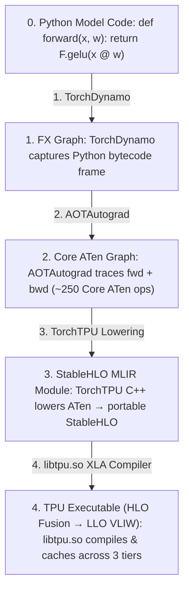

# Unit 1.2: Execution Modes — Strict Eager, Defer-and-Fuse, `torch.compile` & `@jax.jit`

## 1. Learning Objectives & Production Context

By the end of this unit, you will be able to:
1. Contrast the 4 execution modes available across TorchTPU and JAX:
   * **TorchTPU Strict Eager (`TORCH_TPU_DEFER_AND_FUSE=0`)**
   * **TorchTPU Defer-and-Fuse Eager (`TORCH_TPU_DEFER_AND_FUSE=1`)**
   * **TorchTPU Compiled (`torch.compile(fn, backend="tpu", dynamic=False)`)**
   * **JAX JIT Compiled (`@jax.jit`)**
2. Explain **Operator Fusion** from a hardware Roofline perspective (Arithmetic Intensity, HBM bytes transferred vs. VMEM residency).
3. Trace the 4 compiler stages of `torch.compile(backend="tpu")`: **TorchDynamo -> AOTAutograd -> Core ATen / StableHLO -> XLA HLO/LLO**.

## 2. Why Uncompiled Eager Mode Bottlenecks on HBM Bandwidth

Consider a simple neural activation block operating on a tensor $X$ of shape `(4096, 4096)` in `bfloat16` (`32 MiB`):

```python
def f(x):
    a = x * 0.5
    b = torch.tanh(a)
    c = x + b
    return c * 1.4142
```

### What Happens in Strict Eager Mode (`TORCH_TPU_DEFER_AND_FUSE=0`)
In Strict Eager mode, Python dispatches each operator one by one to the TPU:
1. **Op 1 (`a = x * 0.5`)**: Read `x` (`32 MiB`) from HBM -> VMEM, multiply by `0.5` in VPU, write `a` (`32 MiB`) back to HBM. *(64 MiB HBM traffic)*.
2. **Op 2 (`b = tanh(a)`)**: Read `a` (`32 MiB`) from HBM -> VMEM, compute `tanh`, write `b` (`32 MiB`) to HBM. *(64 MiB HBM traffic)*.
3. **Op 3 (`c = x + b`)**: Read `x` (`32 MiB`) + `b` (`32 MiB`) from HBM -> VMEM, add, write `c` (`32 MiB`) to HBM. *(96 MiB HBM traffic)*.
4. **Op 4 (`c * 1.4142`)**: Read `c` (`32 MiB`) from HBM -> VMEM, multiply, write output (`32 MiB`) to HBM. *(64 MiB HBM traffic)*.

* **Total HBM Memory Traffic (Unfused)**: **$288 \text{ MiB}$** plus 4 separate host-to-TPU kernel launch round-trips!

### What Happens with XLA Operator Fusion (`torch.compile` or `@jax.jit`)
When compiled with `torch.compile(f, backend="tpu")` or `@jax.jit`, XLA's fusion pass combines all 4 operations into **one single fused kernel**:
1. DMA reads `x` (**`32 MiB`**) from HBM into on-chip **VMEM** once.
2. The VPU executes `* 0.5`, `tanh`, `+ x`, and `* 1.4142` back-to-back inside VMEM registers without touching HBM.
3. DMA writes the final output (**`32 MiB`**) from VMEM back to HBM once.

* **Total HBM Memory Traffic (Fused)**: **$64 \text{ MiB}$** (**4.5x reduction in HBM memory bandwidth** and only 1 kernel launch!).

## 3. The 4 Execution Modes on TPU Compared

In `torch_tpu 0.2.0+` (`torch_tpu/_internal/eager/__init__.py`), you can control eager execution behavior either via environment variables (`TORCH_TPU_DEFER_AND_FUSE=1`), by assigning to the module property **`torch.tpu.eager_mode`**, or inside a scoped block using the context manager **`with torch.tpu.set_eager_mode(mode):`**:
* `torch.tpu.EagerMode.DEFER_NEVER`: Strict op-by-op eager execution (default).
* `torch.tpu.EagerMode.DEFER_NEVER_AND_LAUNCH_BLOCKING`: Synchronous op-by-op eager execution for pinpointing exact Python stack traces on NaN/shape errors.
* `torch.tpu.EagerMode.DEFER_AND_FUSE`: Queues ATen ops lazily and fuses them at synchronization boundaries.
* *(Internal debug mode)* `torch.tpu.EagerMode.INTERNAL_COMPILE_FX_GRAPH`: Traces eager ops through an FX graph compilation path.

```python
import torch

# 1. Global property assignment (getter / setter):
torch.tpu.eager_mode = torch.tpu.EagerMode.DEFER_NEVER

# 2. Scoped context manager (@contextlib.contextmanager):
with torch.tpu.set_eager_mode(torch.tpu.EagerMode.DEFER_AND_FUSE):
    y = neural_block(x)
```

| Execution Mode | How to Enable | How It Works Under the Hood | When to Use |
| :--- | :--- | :--- | :--- |
| **1. TorchTPU Strict Eager** | `torch.tpu.eager_mode = torch.tpu.EagerMode.DEFER_NEVER` (Default) | Compiles and executes every single ATen op immediately as a 1-op XLA graph. | Debugging exact line-by-line shape/NaN errors (`EagerMode.DEFER_NEVER_AND_LAUNCH_BLOCKING`). Never use for benchmarking. |
| **2. TorchTPU Defer-and-Fuse Eager** | `with torch.tpu.set_eager_mode(torch.tpu.EagerMode.DEFER_AND_FUSE):` (or `TORCH_TPU_DEFER_AND_FUSE=1`) | Queues ATen ops into a lazy buffer and compiles & fuses the accumulated subgraph when a sync barrier (`print`, `.item()`, `.cpu()`, `torch.accelerator.synchronize()`) occurs. | Running legacy eager scripts that cannot yet use `torch.compile` cleanly. |
| **3. TorchTPU `torch.compile`** | `torch.compile(model, backend="tpu", dynamic=False)` *(or simply `torch.compile(model)` with `TORCH_DEVICE_BACKEND_AUTOLOAD=1`)* | **TorchDynamo** captures the full Python frame into an FX graph; **AOTAutograd** traces forward+backward into Core ATen; TorchTPU lowers to **StableHLO**; XLA compiles a single fused TPU binary. | **Production standard** for all TorchTPU training and inference workloads. |
| **4. JAX `@jax.jit`** | `@jax.jit` on `def step(params, x): ...` | Traces the pure Python function with abstract `ShapedArray` tracers into a `jaxpr`, lowers to **StableHLO**, and compiles a single XLA TPU executable. | **Production standard** for all JAX training and inference workloads. |

## 4. Inside the `torch.compile(backend="tpu")` Pipeline



## 5. Guided Hands-On Lab (`labs/lab_02_execution_modes_benchmark.py`)

Examine `labs/lab_02_execution_modes_benchmark.py` in the right-hand code editor:
1. It defines a multi-layer MLP block (`Linear -> GELU -> Residual Add -> LayerNorm`) with identical weights in PyTorch and JAX.
2. It measures **Cold-Start Compilation Time (Step 1)** vs. **Warm Steady-State Latency (Steps 2–20)** across:
   * Uncompiled Eager PyTorch
   * Compiled PyTorch (`torch.compile`)
   * Uncompiled Eager JAX
   * Compiled JAX (`@jax.jit`)
3. It computes the **Fusion Speedup Ratio** and verifies numerical output parity across all modes.

Click **Run Code** to execute the benchmark.
