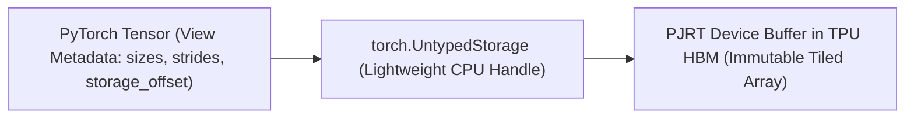

# Unit 2.2: Asynchronous Dispatch, Eliminating Host Stalls & TorchTPU Error Glossary

## 1. Learning Objectives & Production Context

By the end of this unit, you will be able to:
1. Explain how **Asynchronous Host-Device Dispatch** overlaps Python host execution with TPU TensorCore execution.
2. Identify every Python operation that triggers a **Host-Device Synchronization Stall** (`loss.item()`, `print(tensor)`, `tensor.cpu()`, Python `if tensor:` branching).
3. Implement **Detached Device-Side Loss Accumulation** in TorchTPU and **`jax.lax.scan` Multi-Step Fusion** in JAX to eliminate host stalls.
4. Diagnose and fix the top production TorchTPU errors (`@torch.inference_mode()` crash with `torch.compile`, `TORCH_SHOW_CPP_STACKTRACES=1`, `TORCH_TPU_LAUNCH_BLOCKING=1`, and `OpTracer`).

## 2. How Asynchronous Dispatch Works on TPUs

Compiled TPU programs (`torch.compile` and `@jax.jit`) execute **asynchronously** with respect to the Python host thread:
* When Python calls `loss = compiled_step(batch)`, the call returns control to Python in microseconds **before the TPU has even started computing the step**.
* While the TPU is executing Step 1, Python runs ahead to prepare and enqueue Step 2, Step 3, and Step 4 into the `libtpu` device queue.
* As long as the device queue never empties, the TPU executes back-to-back steps with **zero idle gaps**.

```schematic
host-device-timeline
```

## 3. The Two Production Patterns for Stall-Free Training

### Pattern A: TorchTPU Detached On-Device Loss Accumulation
Never call `loss.item()` on every step. Instead, maintain a scalar tensor `running_loss` **on the TPU** and accumulate `loss.detach()` (so the autograd graph is not kept alive across steps). Only copy `running_loss.item()` to the CPU once every `LOG_INTERVAL` steps:

```python
running_loss = torch.zeros((), dtype=torch.float32, device=device)

for step, (x, y) in enumerate(dataloader, start=1):
    loss = compiled_train_step(model, optimizer, x, y)
    # Stays 100% on TPU HBM! Zero host-device synchronization!
    running_loss += loss.detach()

    if step % LOG_INTERVAL == 0:
        # Only 1 host sync every LOG_INTERVAL steps
        avg_loss = (running_loss / LOG_INTERVAL).item()
        running_loss.zero_()
        print(f"Step {step} | Avg Loss: {avg_loss:.5f}")
```

### Pattern B: JAX `jax.lax.scan` Multi-Step Loop Fusion
In JAX, you can go one step further: instead of launching $K$ separate steps from a Python `for` loop, `jax.lax.scan` compiles **$K$ training steps into a single XLA `while` loop** that runs entirely on the TPU with zero Python interaction for all $K$ steps:

```python
@jax.jit
def train_k_steps(params, opt_state, batch_sequence):
    def body_fn(carry, batch):
        p, o_state = carry
        x_b, y_b = batch
        loss_val, grads = jax.value_and_grad(loss_fn)(p, x_b, y_b)
        p, o_state = update_params(p, o_state, grads)
        return (p, o_state), loss_val

    # Executes all K steps inside one XLA call on the TPU!
    (final_params, final_opt_state), per_step_losses = jax.lax.scan(
        body_fn, (params, opt_state), batch_sequence
    )
    return final_params, final_opt_state, jnp.mean(per_step_losses)
```

## 4. The TorchTPU Memory Model (`docs/torchtpu_memory_model.md`)

Understanding how TorchTPU bridges PyTorch's imperative, stride-based tensor model with XLA's immutable, tiled buffer model is essential for avoiding hidden HBM copies and memory bloat:



| Memory Mechanism | How It Works in TorchTPU (`docs/torchtpu_memory_model.md`) | Performance Impact & Best Practice |
| :--- | :--- | :--- |
| **1. `UntypedStorage` Indirection** | A TPU `torch.Tensor` holds CPU-side metadata (`sizes`, `strides`, `storage_offset`) pointing to a lightweight `UntypedStorage` wrapper around an opaque **PJRT TPU HBM buffer**. | Creating views (`x.view(...)`, `x.transpose(...)`, `x[:, :128]`) in Python only mutates CPU metadata (`0` HBM bytes copied at view creation). |
| **2. View Decomposition (`as_strided` $\rightarrow$ StableHLO)** | When a view is consumed by a compiled or eager TPU op, TorchTPU decomposes the `as_strided` metadata into native **StableHLO `slice`, `reshape`, and `transpose` ops** that XLA fuses directly into the consumer kernel's DMA read! | Standard views (`view`, `transpose`, contiguous `slice`, `unbind`) are **zero-copy** inside `torch.compile`. Avoid exotic overlapping or negative strides that cannot decompose cleanly. |
| **3. View Inversion Trap (Partial In-Place Write)** | What if you mutate a slice in-place (`x[:, 0] = val`)? Because PJRT buffers are immutable to XLA ops, TorchTPU executes **View Inversion**: it lowers the slice write to `stablehlo.dynamic_update_slice` on the base buffer. | In **eager mode**, `x[:, 0] = val` must read and rewrite the **entire base tensor `x`** in HBM (`tt_jit_copy__as_strided_inverse`). Inside **`torch.compile`**, XLA's buffer aliasing pass mutates the slice in-place. |
| **4. Auto-Functionalization & Buffer Donation** | PyTorch optimizers (`step()`) and caches mutate tensors in-place. AOTAutograd converts in-place ops into functional ops (`auto_functionalized`), and TorchTPU marks mutated input buffers with `tf.aliasing_output` (**Buffer Donation**). | Donated input buffers are overwritten in-place by XLA (`0` extra HBM allocation). This is why `SingleTraceTrainer` and compiled `StaticCache` have minimal peak HBM. |
| **5. Copy-on-Write (`.clone()`)** | Calling `y = x.clone()` on a TPU tensor does **not** immediately copy HBM bytes! Instead, `y` shares the underlying immutable PJRT buffer with `x` until either `x` or `y` is mutated in-place. | `.clone()` is nearly free when used purely for functional read safety. |

## 5. Production Debugging Playbook: The TorchTPU Error Glossary (`docs/markdown/error_glossary.md`)

When debugging errors in TorchTPU, **asynchronous deferred execution means an exception may be raised many lines after the offending operation** (specifically, at the next `print()`, `.cpu()`, or `.item()` sync barrier). Use these verified techniques from the TorchTPU Error Glossary:

| Symptom / Error Message | Root Cause | Verified Fix |
| :--- | :--- | :--- |
| **`RuntimeError: Inference tensors cannot be saved for backward` or AOTAutograd crash under `torch.compile`** | Decorating an evaluation function with **`@torch.inference_mode()`** while using `torch.compile(backend="tpu")`. Inference mode disables version counters required by TorchDynamo/AOTAutograd graph tracing. | Replace `@torch.inference_mode()` with **`@torch.no_grad()`** whenever using `torch.compile(backend="tpu")`. |
| **`NotImplementedError: Could not run 'aten::...' with arguments from the 'TPU' backend`** | An operator has no lowered `TT_KERNEL` in C++ yet and was called on a TPU tensor. | Wrap the specific unsupported pre/post-processing op in `.cpu()` -> `.to("tpu")`, or implement it via a JAX/Pallas custom op (`torch.tpu.pallas.jax_op`). |
| **Stack trace points to `print(tensor)` instead of the broken op** | In Defer-and-Fuse mode (`TORCH_TPU_DEFER_AND_FUSE=1`), compilation waits until `print(tensor)` flushes the queue. | Set **`TORCH_TPU_LAUNCH_BLOCKING=1`** (or `TORCH_TPU_DEFER_AND_FUSE=0`) and **`TORCH_SHOW_CPP_STACKTRACES=1`** before `import torch` to pinpoint the exact failing Python line and C++ frame. |
| **Inspecting which ATen ops were dispatched** | Need to see exact input/output shapes and dtypes of every ATen op inside a block. | Wrap the block in `from torch_tpu._internal.utils.utils import OpTracer; with OpTracer(): ...` |

## 6. Guided Hands-On Lab (`labs/lab_02_stall_free_training_loop.py`)

Inspect `labs/lab_02_stall_free_training_loop.py` in the right-hand code editor:
1. **Part 1 (TorchTPU)**: Benchmarks 40 training steps comparing **Anti-Pattern (per-step `loss.item()` sync)** against **Best Practice (on-device `running_loss += loss.detach()` synced once every 40 steps)**, and demonstrates **View Inversion (`x[:, :1] = val`)** in Eager vs. Compiled mode.
2. **Part 2 (JAX)**: Benchmarks 40 training steps comparing a **Python `for` loop with per-step `float(loss)`** against **`jax.lax.scan` fusing 40 steps per XLA call**.

Click **Run Code** to measure the throughput speedup from eliminating host stalls.
