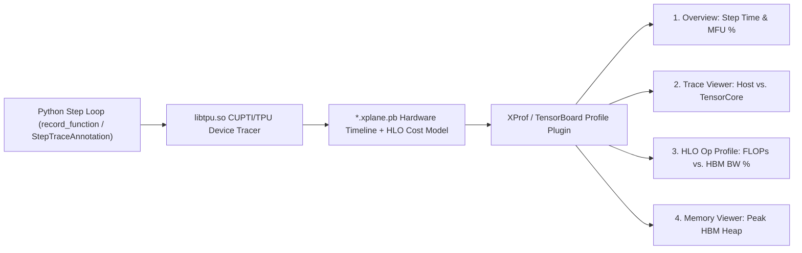

# Unit 3.2: Capturing & Diagnosing XProf Hardware Traces

## 1. Learning Objectives & Production Context

By the end of this unit, you will be able to:
1. Capture hardware-level **XProf** (`.xplane.pb`) traces in both **TorchTPU** (`torch.profiler.profile` with `TpuProfilerConfig`, `record_function`, and `TORCH_TPU_PROFILER_OUTPUT_DIR`) and **JAX** (`jax.profiler.trace`, `StepTraceAnnotation`, and `jax.named_scope`).
2. Trace custom Python scope annotations (`with torch.profiler.record_function("attn_block"):` and `with jax.named_scope("attn_block"):`) directly into the XProf **Trace Viewer** and **HLO Op Profile**.
3. Systematically diagnose the 4 root causes of TPU under-utilization from an XProf trace: **Host-Dispatch Bubbles**, **Dynamic Shape Recompilations**, **Unfused HBM-Bandwidth Bottlenecks**, and **VMEM Spills / Layout Transposes**.

## 2. Capturing XProf Traces in TorchTPU & JAX (`go/tt-devguide`)



### 1. Environment Variables for Automatic Trace Output (`csrc/common/env_vars.h`)
TorchTPU exposes two verified environment variables in `csrc/common/env_vars.h` to configure the output directory and session identifier for XProf captures:

```bash
export TORCH_TPU_PROFILER_OUTPUT_DIR="/tmp/torchtpu_xprof_logs"
export TORCH_TPU_XPROF_SESSION_ID="v6e_llama_benchmark_01"
```

### 2. Programmatic `torch.profiler` + `TpuProfilerConfig` + `record_function`
Always use `torch.profiler.schedule(wait=..., warmup=..., active=...)` so you never capture Step 0 XLA compilation inside your active hardware trace window, and wrap model stages in `torch.profiler.record_function` so HLO ops are grouped by layer in the XProf UI:

```python
import torch
from torch.profiler import ProfilerActivity, profile, record_function, schedule, tensorboard_trace_handler
from torch.tpu.profiler import TpuProfilerConfig

prof_schedule = schedule(wait=1, warmup=2, active=3, repeat=1)
tpu_config = TpuProfilerConfig(host_tracer_level=2, device_tracer_level=1)

with profile(
    activities=[ProfilerActivity.CPU, ProfilerActivity.TPU],
    schedule=prof_schedule,
    experimental_config=tpu_config,
    on_trace_ready=tensorboard_trace_handler("/tmp/torchtpu_xprof_logs"),
) as prof:
    for step in range(6):
        with record_function(f"train_step_{step}"):
            loss = compiled_step(x, y)
        torch.accelerator.synchronize()
        prof.step()
```

### 3. Capturing Step-Annotated XProf Traces in JAX (`StepTraceAnnotation` + `named_scope`)

```python
import jax

with jax.profiler.trace("/tmp/jax_xprof_logs"):
    for step in range(5):
        with jax.profiler.StepTraceAnnotation("train_step", step_num=step):
            with jax.named_scope("transformer_fwd_bwd"):
                params, loss = jit_train_step(params, x, y)
                loss.block_until_ready()
```

## 3. Diagnostic Playbook: Reading the 4 Core XProf Tools

When you load `/tmp/torchtpu_xprof_logs` into TensorBoard / XProf, inspect these four views in sequence:

| XProf Tool | Key Metrics Inspected | Signature of a Bottleneck | Concrete Engineering Fix |
| :--- | :--- | :--- | :--- |
| **1. Overview Page** | **Average Step Time (ms)**, **MXU FLOPs Utilization (%)**, **Infeed / Host Idle (%)**. | `Host Idle > 5%` or red input-bound warning banner. | Remove per-step `.item()` / `print(tensor)` calls, remove 2D Hugging Face `attention_mask` host checks, or fuse loop steps with `jax.lax.scan`. |
| **2. Trace Viewer** | Parallel timeline tracks: **Host Python Threads**, **PJRT Compile**, **TPU TensorCore Ops**, **TPU DMA**. | Gaps ("white space") between consecutive `StepMarker` blocks on the `TPU TensorCore` row while `XlaCompile` or `TransferFromDevice` runs on Host. | Pin static shapes (`dynamic=False`), pad inputs to power-of-2 buckets (`128`, `256`, `512`), and enable `StaticCache` for decoding. |
| **3. HLO Op Profile** | Ranks every HLO op (`fusion`, `dot`, `all-reduce`, `copy`) by **% of Total TPU Time**, **FLOPs %**, and **HBM Bandwidth %**. |1) A `fusion` op takes >15% of step time with **>80% HBM BW** and **<5% MXU FLOPs**. 2) `copy` (relayout/transpose) ops appear near `dot`. | 1) Write a custom **Pallas** kernel (`torch.tpu.pallas.jax_op` or `splash_sdpa`) to keep intermediates in VMEM. 2) Align dimensions to multiples of `(8, 128)` / `256`. |
| **4. Memory Viewer** | Plots **Peak Heap Allocation (GiB)** over the lifetime of the compiled XLA module and lists Largest Live Buffers. | Peak HBM approaches `32 GiB` (`v6e`) or `95 GiB` (`v5p`), or shows sawtooth fragmentation spikes during backward pass. | Use `SingleTraceTrainer` (`use_bfloat16_moments=True` saves 50% optimizer state), enable activation checkpointing (`remat`), or shard via FSDP (Module 5). |

### Worked Case Study: Diagnosing `copy.14` Layout Transpose Overhead in HLO Op Profile
Suppose XProf's **HLO Op Profile** reports that `dot.42` takes `4.1 ms` at `82% MXU utilization`, but right above it `copy.14` takes `1.9 ms` at `0% MXU utilization` and `91% HBM bandwidth`.
* **What `copy` Means in XLA HLO**: On TPU, an HLO `copy` instruction with different minor-to-major layout attributes (`{1,0:T(8,128)}` $\rightarrow$ `{0,1:T(8,128)}`) is not a host copy—it is an **on-device HBM physical relayout/transpose** inserted because a tensor's stride layout does not match the MXU systolic array's required tile layout (`(8, 128)`).
* **How to Fix It**: Check for `.transpose()` / `.contiguous()` or `.unsqueeze(-1)` calls on activations or KV caches right before matmul, or pass pre-transposed column-major weights (as in `torch._scaled_mm`).

## 4. Production XProf Pitfalls & The 8 Canonical TPU Bottleneck Levers (`tpu-diagnostics`)

When analyzing production TorchTPU workloads in XProf (`torchtpu_agents/package/agents/references/tpu-diagnostics.md` & `tpu-roofline.md`), watch out for four hardware-specific profiling traps:

1. **The `custom-call` 0-FLOP / 0-Byte Cost Model Blind Spot**:
   XProf's **HLO Op Profile** computes FLOPs% and HBM Bandwidth% from XLA's static HLO cost analysis. However, custom Pallas/Mosaic kernels (`torch.tpu.ops.splash_sdpa`, `torch.tpu.ops.ragged_dot`, Tokamax, or `torch.tpu.pallas.jax_op`) lower to opaque `custom-call` HLO instructions (`tpu_custom_call`) whose static HLO cost model reports **`0 FLOPs` and `0 Bytes`**.
   * **Impact**: A model spending 40% of its step time inside `splash_sdpa` will appear in XProf's Overview Page to have artificially low overall MXU FLOP utilization! Always compute true **Model FLOPs Utilization (MFU)** analytically from token throughput (`tokens/sec * flops_per_token / peak_hw_flops`) alongside XProf's HLO Op Profile.
2. **Enabling LLO Debug Info Without Distorting Custom-Call Timing**:
   * **DO set**: `export LIBTPU_INIT_ARGS="--xla_xprof_register_llo_debug_info=true"` so XProf maps low-level VLIW bundles back to HLO instructions.
   * **DO NOT set by default**: `--xla_xprof_enable_custom_call_tracing=true` injects synchronization instrumentation inside Pallas/Mosaic custom calls that distorts kernel wall-clock timing. Only enable it momentarily when debugging inside a single custom kernel.
3. **The 256 Contracting-Dimension MXU Padding Trap (`tpu-roofline.md`)**:
   On TPU `v6e` ($256 \times 256$ MXU) and `v5p`, matrix multiplication `C[M, N] = A[M, K] @ B[K, N]` pads the contracting dimension $K$ to a multiple of `256` (and $M, N$ to multiples of `128`/`256`). If an attention projection or LoRA adapter has $K = 64$, the MXU executes `64 / 256 = 25%` useful work per cycle—capping theoretical MXU utilization at 25% even when compute-bound!
4. **The 8 Canonical TPU Optimization Levers (`tpu-diagnostics.md`)**:
   When XProf flags a hotspot, match the symptom to one of these 8 verified levers:
   * **Lever 1 (Host-Device Sync)**: Eliminate `.item()`, `.cpu()`, boolean tensor `if` conditions, and 2D `attention_mask` checks.
   * **Lever 2 (Recompilation Storm)**: Pin static shapes (`dynamic=False`), pad to power-of-2 buckets, or use `StaticCache` / bounded dynamism.
   * **Lever 3 (Unfused Eager / Graph Breaks)**: Wrap in `torch.compile(backend="tpu")`, use `SingleTraceTrainer` (`fullgraph=True`), and inspect breaks with `torch._dynamo.explain`.
   * **Lever 4 (HBM Layout `copy` / `as_strided_inverse`)**: Replace `einops.rearrange` / partial slice writes with contiguous `.view() + .unbind()` and `keepdim=True`.
   * **Lever 5 (Tile Padding Waste)**: Pad vocabulary size, hidden dimensions, and batch sizes to multiples of `128` (`v5p`) or `256` (`v6e`).
   * **Lever 6 (Quadratic Attention / Mask HBM Bandwidth)**: Replace masked SDPA with `torch.tpu.ops.splash_sdpa` or `tokamax.dot_product_attention`.
   * **Lever 7 (MoE Dynamic Token Routing)**: Replace per-expert Python loops and `torch.where` with `torch.tpu.ops.ragged_dot`.
   * **Lever 8 (Collective / FSDP Overhead)**: Migrate from `FSDPv2` hooks to `SimpleFSDP` (`DTensor`) or `@torch.tpu.distributed.spmd_safe` functional collectives.

## 5. Guided Hands-On Lab (`labs/lab_02_capture_xprof_trace.py`)

Click **Run Code** in the right-hand pane to execute `labs/lab_02_capture_xprof_trace.py`. It executes a step-annotated Transformer training loop across both **TorchTPU** (`record_function`) and **JAX** (`StepTraceAnnotation` + `named_scope`), captures profiler artifacts into `/tmp/tpu_lab_xprof`, and prints a diagnostic breakdown of warmup vs. steady-state step latencies and generated `.xplane.pb` trace files.
