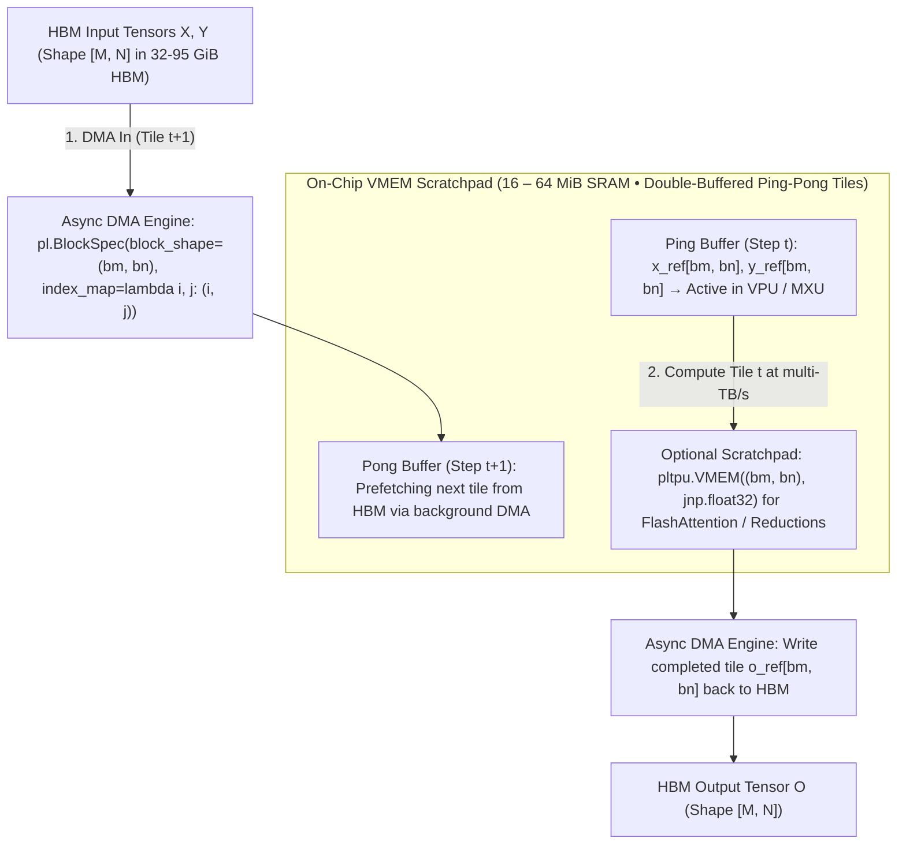

# Unit 4.1: Pallas Programming Model — VMEM Scratchpads, `BlockSpec` & DMA Pipelining

## 1. Learning Objectives & Production Context

By the end of this unit, you will be able to:
1. Explain when and why to write a custom **Pallas** kernel (`jax.experimental.pallas`) instead of relying on default XLA compiler fusion.
2. Calculate exact **On-Chip VMEM Scratchpad Footprints** (including double-buffered inputs, outputs, and `pltpu.VMEM` accumulators) to prevent `RESOURCE_EXHAUSTED: Mosaic failed to compile: VMEM out of memory`.
3. Enforce TPU **Vector Register (`VREG`) `(8, 128)` sublane/lane alignment rules** and understand how **DMA Double-Buffering** overlaps HBM tile transfers with MXU/VPU execution.
4. Write and execute a tiled Pallas kernel with `pl.pallas_call`.

## 2. How Pallas Works: Explicit VMEM & DMA Pipelining

While XLA's automatic `kLoop` / `kInput` fusion handles elementwise chains well, algorithms like **FlashAttention / SplashAttention**, **Register-Level `int8`/`fp4` Quantization & Bit-Packing**, and **Ragged MoE Routing (`ragged_dot`)** require explicit control over **which tiles stay resident in on-chip VMEM (`16–64 MiB` SRAM) and Vector Registers (`VREGs`)** across loop iterations so intermediate `[B, H, S, S]` matrices are never written to HBM.



### How Double-Buffered Grid Pipelining Hides HBM Latency
When you specify a `grid = (M // bm, N // bn)` in `pl.pallas_call`, the TPU Mosaic compiler automatically **double-buffers (ping-pongs)** every input and output `BlockSpec` in VMEM:
* **During Grid Step $t$**:
  1. **DMA In Engine**: Prefetches tile $t+1$ from HBM into VMEM **Pong Buffer**.
  2. **MXU / VPU**: Computes on tile $t$ inside VMEM **Ping Buffer**.
  3. **DMA Out Engine**: Drains completed output tile $t-1$ from VMEM back to HBM.
* As long as the compute time on tile $t$ exceeds the DMA transfer time of tile $t+1$, **100% of HBM latency is hidden**.

## 3. VMEM Scratchpad Sizing Math & The `(8, 128)` Hardware Rule

Because every tiled input and output `Ref` is double-buffered (`buffer_count = 2` by default), the total VMEM bytes consumed by a Pallas kernel with input tile sizes $\{B_{\text{in}}\}$, output tile sizes $\{B_{\text{out}}\}$, and explicit scratch buffers $B_{\text{scratch}}$ is:

$$\text{VMEM}_{\text{total}} = 2 \times \left(\sum_{k \in \text{inputs}} B_{\text{in}, k} + \sum_{m \in \text{outputs}} B_{\text{out}, m}\right) + B_{\text{scratch}} \le \text{VMEM}_{\text{limit}}$$

> **Worked Example — Sizing Tiles for `fused_gated_silu(x, gate)` in `bfloat16` (`2 bytes`)**:
> * **Kernel Signature**: 2 inputs (`x_ref`, `gate_ref`) and 1 output (`out_ref`), each of block shape `(bm, bn)` in `bfloat16` (`2 B`), plus `float32` (`4 B`) intermediate registers/scratch.
> * **Case A: Tile `(256, 256)`**:
>   $$\text{Single Tile} = 256 \times 256 \times 2\text{ B} = 128\text{ KiB}$$
>   $$\text{VMEM}_{\text{total}} = 2 \times (128\text{ KiB} + 128\text{ KiB} + 128\text{ KiB}) = \mathbf{768\text{ KiB}} \ll 16\text{ MiB} \quad (\text{Fits easily!})$$
> * **Case B: Oversized Tile `(2048, 2048)` in `float32` (`4 bytes`)**:
>   $$\text{Single Tile} = 2048 \times 2048 \times 4\text{ B} = 16\text{ MiB} \implies \text{VMEM}_{\text{total}} = 2 \times 3 \times 16\text{ MiB} = \mathbf{96\text{ MiB}} \quad (\text{OOMs VMEM!})$$
> * **Golden Rule for Pallas Tile Shapes**: Keep total double-buffered tile footprint between **`512 KiB` and `8 MiB`** (typical tile sizes: `(128, 128)`, `(256, 256)`, `(512, 512)`, or `(1024, 128)`).

### Why TPU `block_shape` Must Be Divisible by `(8, 128)`
Inside the TPU TensorCore, every **Vector Register (`VREG`)** is physically wired as a 2D array of **8 sublanes $\times$ 128 lanes** of 32-bit words (`1,024` elements per VREG).
* Consequently, the TPU Mosaic compiler requires the **last two dimensions (`[-2]` and `[-1]`) of every `BlockSpec` `block_shape` to be multiples of `(8, 128)`** (or equal to the entire tensor dimension if smaller).
* Always pass `block_shape` and `index_map` as **keyword arguments**:
  ```python
  pl.BlockSpec(block_shape=(bm, bn), index_map=lambda i, j: (i, j))
  ```

### Allocating Explicit VMEM Accumulators (`pltpu.VMEM`) for Reductions
When writing reduction kernels (such as FlashAttention or matrix multiplication over a contracting $K$ grid axis `grid = (M // bm, N // bn, K // bk)`), use `jax.experimental.pallas.tpu.VMEM` (`pltpu.VMEM`) via `scratch_shapes` or initialize the output `o_ref` on `pl.program_id(axis=2) == 0`:

```python
from jax.experimental import pallas as pl
from jax.experimental.pallas import tpu as pltpu

def matmul_kernel(x_ref, y_ref, o_ref, acc_vmem_ref):
    k_step = pl.program_id(axis=2)
    @pl.when(k_step == 0)
    def _init():
        acc_vmem_ref[:, :] = jnp.zeros_like(acc_vmem_ref)

    acc_vmem_ref[:, :] += jnp.matmul(
        x_ref[:, :], y_ref[:, :], preferred_element_type=jnp.float32
    )
```

## 4. Guided Hands-On Lab (`labs/lab_01_pallas_fused_kernel_jax.py`)

Click **Run Code** to execute `labs/lab_01_pallas_fused_kernel_jax.py`, which implements a tiled Pallas `fused_gated_silu_kernel`, computes the exact double-buffered VMEM scratchpad footprint (`KiB`) and HBM traffic reduction (`3.0x` fewer HBM bytes vs. unfused eager ops), and verifies zero numerical drift against standard JAX.
