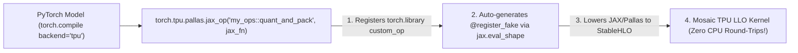

# Unit 4.2: Integrating Pallas Kernels into TorchTPU (`torch.tpu.pallas.jax_op`) & LLO Inspection

## 1. Learning Objectives & Production Context

By the end of this unit, you will be able to:
1. Embed any JAX or Pallas kernel directly inside a **PyTorch `torch.compile(backend="tpu")`** model with **zero host-device copies** using `torch.tpu.pallas.jax_op("namespace::op_name", jax_fn)`.
2. Walk through the complete production **`quant_and_pack`** case study from the TorchTPU Developer Guide (`go/tt-devguide`): why standard XLA `torch.compile` spills sub-32-bit bit-shifts to VMEM, and how Pallas (`pltpu.bitcast`) compiles register-level packing into **3 TPU LLO VLIW hardware instructions** (`ftoi.rn.bf16`, `pack.b8`, `vst`).
3. Support **training backward passes** through custom Pallas ops in PyTorch using `torch.autograd.Function` + `jax_op`.
4. Dump and inspect low-level TPU **LLO VLIW assembly** using `LIBTPU_INIT_ARGS="--xla_jf_dump_to=/tmp/llo_dump --xla_jf_dump_llo_text=true"`.

## 2. How `torch.tpu.pallas.jax_op` Bridges PyTorch and JAX at the StableHLO Level

Because both **TorchTPU** and **JAX** lower their operations to **StableHLO** MLIR before passing the graph to `libtpu.so`, TorchTPU (`torch_tpu/_internal/pallas/pallas.py`) provides a direct zero-copy bridge (`torch.tpu.pallas.jax_op`):



### Complete Production Example: Register-Level `quant_and_pack` (`go/tt-devguide`)
Suppose we want to quantize a `bfloat16` activation tensor $X$ of shape `[M, K]` into `int8` and pack four `int8` values into a single 32-bit `int32` word `[M, K // 4]` (cutting HBM write traffic by **2× vs `int8`** and **4× vs `bfloat16`**):

```python
import torch
import torch_tpu
import jax
import jax.numpy as jnp
from jax.experimental import pallas as pl
from jax.experimental.pallas import tpu as pltpu

# 1. Pallas Kernel: Quantize bf16 -> int8 and pack 4x int8 into 1x int32 in VREGs
def quant_and_pack_kernel(x_ref, scale_ref, out_ref):
    scale = scale_ref[0, 0]
    # Load 4 column tiles of bf16 into VREGs and quantize to int8 [-128, 127]
    q0 = jnp.clip(jnp.round(x_ref[:, 0::4] / scale), -128, 127).astype(jnp.int8)
    q1 = jnp.clip(jnp.round(x_ref[:, 1::4] / scale), -128, 127).astype(jnp.int8)
    q2 = jnp.clip(jnp.round(x_ref[:, 2::4] / scale), -128, 127).astype(jnp.int8)
    q3 = jnp.clip(jnp.round(x_ref[:, 3::4] / scale), -128, 127).astype(jnp.int8)

    # Pack four 8-bit registers into one 32-bit int32 register via bit-shifts / pltpu.bitcast
    packed = (
        (q0.astype(jnp.uint8).astype(jnp.uint32))
        | (q1.astype(jnp.uint8).astype(jnp.uint32) << 8)
        | (q2.astype(jnp.uint8).astype(jnp.uint32) << 16)
        | (q3.astype(jnp.uint8).astype(jnp.uint32) << 24)
    )
    out_ref[:, :] = pltpu.bitcast(packed, jnp.int32)

# 2. Wrap Pallas call in a pure JAX function
def quant_and_pack_jax(x: jax.Array, scale: jax.Array) -> jax.Array:
    m, k = x.shape
    bm, bk = min(m, 128), min(k, 512)
    return pl.pallas_call(
        quant_and_pack_kernel,
        out_shape=jax.ShapeDtypeStruct((m, k // 4), jnp.int32),
        grid=(m // bm, k // bk),
        in_specs=[
            pl.BlockSpec(block_shape=(bm, bk), index_map=lambda i, j: (i, j)),
            pl.BlockSpec(block_shape=(1, 1), index_map=lambda i, j: (0, 0)),
        ],
        out_specs=pl.BlockSpec(block_shape=(bm, bk // 4), index_map=lambda i, j: (i, j)),
    )(x, scale)

# 3. Bridge into TorchTPU as a native PyTorch op in 1 line:
torch_quant_and_pack = torch.tpu.pallas.jax_op("tpu_lab::quant_and_pack", quant_and_pack_jax)
```

### Supporting Autograd Backward Passes (`jax_op.register_autograd`)
`torch.tpu.pallas.jax_op` returns a `_JaxCustomOpDef` (wrapping PyTorch's `torch.library.custom_op`). To make a custom Pallas kernel differentiable inside `torch.compile(..., fullgraph=True)` without graph breaks, register its backward pass using **`op.register_autograd(backward_fn, setup_context=setup_context_fn)`** (`docs/custom_kernels.md`):

```python
rmsnorm_fwd_op = torch.tpu.pallas.jax_op("tpu_lab::rmsnorm_fwd", rmsnorm_fwd_jax)
rmsnorm_bwd_op = torch.tpu.pallas.jax_op("tpu_lab::rmsnorm_bwd", rmsnorm_bwd_jax)

def _setup_context(ctx, inputs, output):
    x, weight = inputs
    out, rstd = output
    ctx.save_for_backward(x, weight, rstd)

def _backward(ctx, grad_out, _grad_rstd):
    x, weight, rstd = ctx.saved_tensors
    dx, dweight = rmsnorm_bwd_op(grad_out, x, weight, rstd)
    return dx, dweight

# Registers AOTAutograd-compatible backward rule directly on the custom op!
rmsnorm_fwd_op.register_autograd(_backward, setup_context=_setup_context)
```

## 3. Verifying Kernel Quality via TPU LLO VLIW Assembly Dumps

To inspect the exact VLIW assembly instructions (**LLO — Low-Level Optimizer**) emitted by the TPU compiler, set `LIBTPU_INIT_ARGS` **before** importing `torch`:

```python
import os, sys
os.environ["LIBTPU_INIT_ARGS"] = "--xla_jf_dump_to=/tmp/llo_dump --xla_jf_dump_llo_text=true"
sys.argv.extend(["--xla_jf_dump_to=/tmp/llo_dump", "--xla_jf_dump_llo_text=true"])
import torch
import torch_tpu
```

| Implementation | What Happens in TPU LLO (`*llo.txt`) | HBM / VMEM Traffic & Performance |
| :--- | :--- | :--- |
| **Naive PyTorch Bit-Shift (`torch.compile`)** | XLA unpacks sub-32-bit shifts by spilling intermediate vectors to VMEM via repeated **`vst` (vector store)** and **`vld` (vector load)** instructions across loop iterations. | VMEM bandwidth bottlenecked; **~3.4× slower**. |
| **Pallas `quant_and_pack` (`jax_op`)** | Compiles each tile iteration into **3 register-resident VPU instructions**: 1) **`vs32 = ftoi.rn.bf16`** (float-to-int round-to-nearest), 2) **`pack.b8`** (hardware byte pack of four 8-bit VREGs into one 32-bit VREG), 3) **`vst`** (single contiguous 32-bit store). | Zero VMEM spills; saturates HBM bandwidth. |

## 4. The Broader TorchTPU Kernel Ecosystem: Tokamax, Helion & Distributed Pallas (`docs/custom_kernels.md`)

Beyond single-chip Pallas kernels, TorchTPU supports three additional custom kernel workflows (`docs/custom_kernels.md` & `torchtpu_agents/package/agents/tpu-kernel-development.md`):

| Kernel Framework | Abstraction Level | Primary Use Case on TorchTPU |
| :--- | :--- | :--- |
| **1. `torch.tpu.ops` (`splash_sdpa`, `ragged_dot`)** | Built-in pre-wrapped Pallas/Mosaic ops shipped with `torch_tpu` | Drop-in GQA/Sliding-Window Splash Attention and MoE Ragged Dot without writing JAX code. |
| **2. Tokamax (`tokamax`)** | Pre-tuned library of JAX/Pallas kernels (`tokamax.dot_product_attention`, `tokamax.ragged_dot`, `tokamax.layer_norm`) | Bridged into PyTorch via `torch.tpu.pallas.jax_op` when you need custom autotuned tiling configs or specialized attention variants. |
| **3. Helion (`@helion.kernel`)** | High-level tile-centric Python DSL that compiles directly to Pallas/Mosaic on TPU (`examples/helion/`) | Writing concise Triton-style tiled kernels in pure PyTorch syntax without explicit `BlockSpec` boilerplate. |
| **4. Multi-Chip Distributed Pallas (`get_pallas_mesh`)** | Low-level SPMD Pallas with explicit ICI RDMA (`pltpu.make_async_remote_copy`) | Overlapping ICI ring communication with MXU compute inside a single kernel (`examples/pallas/distributed/`). |

### Bridging Multi-Chip Distributed Pallas Kernels (`torch.tpu.pallas.get_pallas_mesh`)
To invoke a multi-chip Pallas kernel that performs direct chip-to-chip ICI RDMA copies (`jax.experimental.shard_map.shard_map` + `pltpu.make_async_remote_copy`) from a `torchrun` PyTorch process group, pass **`torch.tpu.pallas.get_pallas_mesh()`** into `shard_map` and decorate the compiled caller with **`@torch.tpu.distributed.spmd_safe`**:

```python
import jax
from jax.experimental import pallas as pl
from jax.experimental.pallas import tpu as pltpu
from jax.sharding import PartitionSpec as P
import torch

def distributed_pallas_fn(x_jax: jax.Array) -> jax.Array:
    # Retrieves the active multi-chip JAX Mesh matching TorchTPU's tpu_dist topology
    mesh = torch.tpu.pallas.get_pallas_mesh(axis_names=("tp",))
    @jax.shard_map(mesh=mesh, in_specs=P("tp", None), out_specs=P("tp", None), check_vma=False)
    def _per_chip(local_x):
        return local_x * 2.0  # Or pl.pallas_call with pltpu.make_async_remote_copySemaphore
    return _per_chip(x_jax)

dist_op = torch.tpu.pallas.jax_op("tpu_lab::dist_op", distributed_pallas_fn)
```

## 5. Guided Hands-On Lab (`labs/lab_02_pallas_in_torch_compile.py`)

Click **Run Code** to execute `labs/lab_02_pallas_in_torch_compile.py`. It implements a **Fused Pallas RMSNorm Kernel** (forward + backward), registers its autograd pass via `register_autograd(backward_fn, setup_context=...)`, runs a compiled forward + backward step in PyTorch (`torch.compile`), and verifies numerical parity between PyTorch and JAX Pallas.
