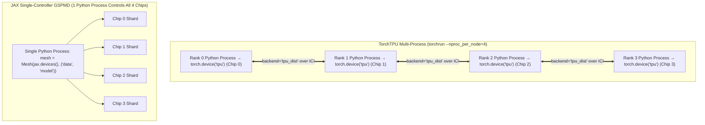

# Unit 5.2: TorchTPU `DDP` / `FSDP` vs. JAX 2D `NamedSharding` & End-to-End Transformer Benchmark

## 1. Learning Objectives & Production Context

By the end of this unit, you will be able to:
1. Launch multi-chip distributed training in **TorchTPU** (`eval $(python -m torch.tpu.distributed | sed 's/^/export /')`, `dist.init_process_group(backend="tpu_dist")`, `DDP`, and `SimpleFSDP`) and **JAX** (`Mesh`, `NamedSharding`, `PartitionSpec`).
2. Design a **2D FSDP $\times$ Tensor Parallelism (Megatron-Style) Sharding Mesh** (`mesh = Mesh(devices, ("data", "model"))`) that shards both parameters and intermediate activations across chips.
3. Calculate exact **End-to-End Transformer Decoder FLOPs per Step** and benchmark TorchTPU vs. JAX throughput (`tokens/sec`, `TFLOPs/sec`, and `MFU %`).

## 2. Side-by-Side Distributed Setup: TorchTPU Multi-Process vs. JAX GSPMD



### 1. TorchTPU Multi-Chip Launch (`python -m torch.tpu.distributed` & `set_tpu_launch_env`)
Per `docs/distributed_training_101.md` and `torch_tpu/examples/`, before launching `torchrun` (or inside a custom Python launcher before `dist.init_process_group`), configure the PJRT coordinator port and topology variables using either the CLI module or `torch.tpu.distributed.set_tpu_launch_env()`:

```bash
eval $(python -m torch.tpu.distributed | sed 's/^/export /')
torchrun --nnodes=1 --nproc_per_node=4 train_ddp.py
```

Inside `train_ddp.py`, initialize the native `"tpu_dist"` collective backend. In multi-process mode, each worker process is bound exclusively to its assigned chip as `torch.device("tpu")`:

```python
import torch
import torch.distributed as dist
from torch.nn.parallel import DistributedDataParallel as DDP

# Optional programmatic setup if not exported in bash:
# torch.tpu.distributed.set_tpu_launch_env()

# Initialize native TorchTPU PJRT collective backend over ICI
dist.init_process_group(backend="tpu_dist")

device = torch.device("tpu")
model = MyTransformer().to(device=device, dtype=torch.bfloat16)

# Option A: DDP (pass gradient_as_bucket_view=True to avoid extra HBM grad copies)
ddp_model = DDP(model, gradient_as_bucket_view=True)
compiled_model = torch.compile(ddp_model, backend="tpu", dynamic=False)
```

### 2. TorchTPU `FSDPv2` vs. `SimpleFSDP` (`3.3x` Speedup on `v6e-8`)
In the open-source `torch_tpu/examples/fsdp/fsdp_to_simple_fsdp/` benchmark on **`v6e-8`** (`8 chips`), migrating a Transformer training loop from PyTorch's standard `FSDPv2` (`fully_shard`) to TorchTPU's compiler-native **`SimpleFSDP`** (`import simple_fsdp` from `examples/fsdp/simple_fsdp.py` in the OSS repo, or `from torch_tpu.perflab.trainers import simple_fsdp` in internal `perflab`) reduced steady-state step latency from **`155 ms` to `47 ms` (3.3x faster)**:

| Feature / Mechanism | PyTorch `FSDPv2` (`fully_shard`) | TorchTPU `SimpleFSDP` (`simple_fsdp.data_parallel`) |
| :--- | :--- | :--- |
| **How `AllGather` / `ReduceScatter` Run** | Imperative pre/post-forward Python module hooks that break whole-model graph capture. | Pure `DTensor.redistribute` operations (`Shard(0)` -> `Replicate()` -> `Partial(reduce_op="sum")`) traced into **one unbroken XLA graph**. |
| **Activation Checkpointing** | `checkpoint_wrapper` around each layer before `fully_shard(layer)`. | Standard `torch.utils.checkpoint.checkpoint(layer, x, use_reentrant=False)` inside `forward()`, wrapped once at the top level via `simple_fsdp.data_parallel(...)`. |
| **Gradient Reduction Scaling** | Defaults to **`avg`** reduction across ranks (`loss.backward()`). | Uses **`sum`** reduction (`Partial(reduce_op="sum")`); **always scale loss via `(loss / world_size).backward()`**! |
| **Measured Step Latency (`v6e-8`)** | `~270 ms` (eager) / `~155 ms` (per-block `torch.compile`) | **`~47 ms` (`3.3x` faster than compiled FSDPv2)** |

### 3. Declarative `DTensor` Tensor Parallelism on TorchTPU (`examples/tensor_parallel/dtensor_wrapped`)
For Megatron-style Tensor Parallelism in PyTorch on TPU, use `torch.distributed.tensor.parallel.parallelize_module` with `ColwiseParallel` and `RowwiseParallel` over a `"tp"` `DeviceMesh`:

```python
from torch.distributed.device_mesh import init_device_mesh
from torch.distributed.tensor import Replicate
from torch.distributed.tensor.parallel import (
    ColwiseParallel, PrepareModuleInput, PrepareModuleOutput, RowwiseParallel, parallelize_module,
)

device_mesh = init_device_mesh("tpu", (world_size,), mesh_dim_names=("tp",))
tp_plan = {
    "mlp": PrepareModuleInput(input_layouts=(Replicate(),), desired_input_layouts=(Replicate(),)),
    "mlp.gate_proj": ColwiseParallel(),  # Shards output columns across TP ranks (0 ICI comm)
    "mlp.up_proj":   ColwiseParallel(),  # Shards output columns across TP ranks (0 ICI comm)
    "mlp.down_proj": RowwiseParallel(),  # Shards input rows & emits 1 AllReduce at block exit
    "output": PrepareModuleOutput(output_layouts=(Replicate(),), desired_output_layouts=(Replicate(),), use_local_output=True),
}
parallelize_module(model, device_mesh, tp_plan)
compiled_model = torch.compile(model, backend="tpu", dynamic=False)
```

> **Tip — Custom Functional Collectives (`@torch.tpu.distributed.spmd_safe`):** When writing custom manual FSDP or ring-attention loops using `torch.ops._c10d_functional.all_gather_into_tensor` and `reduce_scatter_tensor` (`examples/fsdp/manual`), decorate your compiled function with **`@torch.tpu.distributed.spmd_safe`** so the TorchTPU compiler lowers the functional collectives directly into XLA cross-replica HLO ops.

### 4. JAX Single-Controller 2D GSPMD (`FSDP` $\times$ `Tensor Parallelism`)
When a model's activations or KV cache are too large for 1D FSDP alone (or during low-latency multi-chip inference where you want to aggregate HBM bandwidth across $N$ chips at batch size $B=1$), combine **Data/FSDP (`"data"`)** and **Megatron Tensor Parallelism (`"model"`)** across a 2D mesh:

```python
import jax
import numpy as np
from jax.sharding import Mesh, NamedSharding, PartitionSpec as P

# Construct a 2D (data=2, model=2) mesh across 4 TPU chips (e.g. v6e-4 or v5p-8)
devices = np.array(jax.devices()).reshape(2, 2)
mesh = Mesh(devices, axis_names=("data", "model"))

# Megatron-Style 2D Transformer Sharding Recipe:
sharding_rules = {
    "x_batch":  NamedSharding(mesh, P("data", None, None)),    # [B, S, D] sharded along batch
    "w_qkv":    NamedSharding(mesh, P("data", "model")),       # [D, 3*D] Column-Parallel (FSDP on D, TP on heads)
    "w_out":    NamedSharding(mesh, P("model", "data")),       # [D, D]   Row-Parallel (contracts along 'model' via ReduceScatter!)
    "w_gate_up":NamedSharding(mesh, P("data", "model")),       # [D, 2*F] Column-Parallel SwiGLU gate & up
    "w_down":   NamedSharding(mesh, P("model", "data")),       # [F, D]   Row-Parallel SwiGLU down projection
}
```

### Why Column-Parallel (`P("data", "model")`) Followed by Row-Parallel (`P("model", "data")`) Is Optimal
1. **First Matmul ($Y_1 = X W_{\text{up}}$)**: $W_{\text{up}}$ has its output columns partitioned along `"model"`. Each chip computes its $1/\text{TP}$ slice of the SwiGLU activation `silu(gate) * up` **independently with zero ICI communication**!
2. **Second Matmul ($Y_2 = Y_1 W_{\text{down}}$)**: $W_{\text{down}}$ has its input rows partitioned along `"model"`. Multiplying $[B, S, F/\text{TP}] \times [F/\text{TP}, D]$ requires **only a single `AllReduce` (or `ReduceScatter`) at the very end of the block**.

## 3. End-to-End Transformer Decoder FLOPs Formula

For a Decoder-only Transformer with $L$ layers, batch size $B$, sequence length $S$ ($T = B \cdot S$), hidden size $D$, and SwiGLU intermediate dimension $F$:

$$\text{FLOPs}_{\text{fwd, per layer}} = \underbrace{8 B S D^2}_{\text{Q, K, V, Out Proj}} + \underbrace{4 B S^2 D}_{\text{Causal SDPA}} + \underbrace{6 B S D F}_{\text{SwiGLU (Gate, Up, Down)}}$$

For a full training step (**Forward + Backward**), total FLOPs $\approx 3 \times L \times \text{FLOPs}_{\text{fwd, per layer}}$.

## 4. Guided Hands-On Lab (`labs/lab_02_transformer_inference_benchmark.py`)

Click **Run Code** in the right-hand pane to run the capstone **End-to-End Transformer Decoder Benchmark (`labs/lab_02_transformer_inference_benchmark.py`)**, which builds a multi-layer Decoder-only Transformer (Multi-Head Causal Attention + RMSNorm + SwiGLU) in both **PyTorch (`torch_tpu`)** and **JAX**, measures `tokens/sec` and `TFLOPs/sec`, and verifies numerical parity.
