# Unit 6.1: Hugging Face LLMs on TorchTPU — 4D Causal Masks, `StaticCache` & Splash Attention

## 1. Learning Objectives & Production Context

By the end of this unit, you will be able to:
1. Load open-weight Hugging Face `transformers` models (`Qwen/Qwen3-0.6B`, `Qwen/Qwen3-1.7B`, `meta-llama/Llama-3.2-1B`, `google/gemma-2-2b`, `google/gemma-3-270m`) directly onto `torch.device("tpu")` in `bfloat16` without host-memory bloat.
2. Eliminate `transformers.masking_utils` graph breaks under `torch.compile(backend="tpu", dynamic=False)` using either unpadded mask removal or precomputed **4D Causal Masks**.
3. Implement zero-recompilation autoregressive decoding using **`transformers.cache_utils.StaticCache`**, eager prefill, compiled decode steps, and in-place warmup cache rewinding (`torch_tpu/perflab/steps/decode.py`).
4. Accelerate Sliding Window and Grouped-Query Attention (GQA) using TorchTPU's Pallas **`torch.tpu.ops.splash_sdpa`** kernel and **`SDPBackend.OVERRIDEABLE`**.

## 2. Direct-to-TPU Model Initialization & The `@torch.no_grad()` Rule

When instantiating a multi-billion parameter Hugging Face model on a Cloud TPU VM, allocating weights on the Host CPU first and calling `.to("tpu")` afterwards doubles host DRAM pressure and triggers slow PCIe copies. Instead, allocate directly inside a `with torch.device("tpu"):` context or pass `torch_dtype=torch.bfloat16`:

```python
import torch  # Autoloads torch_tpu via TORCH_DEVICE_BACKEND_AUTOLOAD=1
import transformers

device = torch.device("tpu")

# Allocate model parameters directly in bfloat16 on TPU HBM
with torch.device("tpu"):
    model = transformers.AutoModelForCausalLM.from_pretrained(
        "Qwen/Qwen3-0.6B",
        torch_dtype=torch.bfloat16,
        use_cache=False,  # False for training/prefill-only; True with StaticCache for decode
    ).eval()
```

> **Caution — Never Use `@torch.inference_mode()` with `torch.compile(backend="tpu")`:**
> In `torch_tpu` (`docs/markdown/error_glossary.md`), `torch.inference_mode()` disables tensor version counters required by `torch.embedding` and AOTAutograd/TorchDynamo graph capture, raising `RuntimeError: Cannot set version_counter for inference tensor`. **Always use `with torch.no_grad():` for evaluation and inference on TorchTPU.**

## 3. Eliminating Hugging Face `masking_utils` Graph Breaks

When you pass a standard 2D `attention_mask` (shape `[batch_size, seq_len]`) from `AutoTokenizer` into `model(**inputs)`, `transformers.masking_utils` executes Python control-flow heuristics (such as `_ignore_causal_mask_sdpa` and `find_packed_sequence_indices`) that call `.all()` or `.item()` on the mask tensor. On a TPU, inspecting tensor values from Python forces a synchronous device-to-host transfer and causes a **TorchDynamo graph break**.

```mermaid
flowchart TD
    subgraph BAD["Anti-Pattern: Standard 2D attention_mask [B, S]"]
        B1["AutoTokenizer emits 2D attention_mask [B, S]"] --> B2["transformers.masking_utils calls mask.all() / .item()"]
        B2 --> B3["Host CPU blocks on TPU D2H transfer → TorchDynamo Graph Break!"]
    end
    subgraph FIXA["Production Fix A: Full-Length Unpadded Batches"]
        A1["inputs.pop('attention_mask', None)"] --> A2["Model uses native causal mask (is_causal=True)"]
        A2 --> A3["0 Host Syncs • Single Fused XLA Graph"]
    end
    subgraph FIXB["Production Fix B: Padded or Sliding-Window Batches"]
        C1["Precompute 4D Causal Mask [B, 1, S, S] before compiled call"] --> C2["masking_utils takes early return on 4D tensor"]
        C2 --> C3["0 Host Syncs • Single Fused XLA Graph"]
    end
```



### Verified Pattern (`torch_tpu/perflab/model_helpers.py` & `model_utils.py`)

```python
from transformers import masking_utils

# Fix A: When benchmarking or training on fixed-length packed sequences without padding:
inputs.pop("attention_mask", None)

# Fix B: When a mask is required, precompute the 4D mask [B, 1, S, S] before calling the compiled model:
cache_position = torch.arange(seq_len, device=device)
causal_mask_4d = masking_utils.create_causal_mask(
    config=model.config,
    input_embeds=dummy_embeds,  # shape [B, S, D], dtype=torch.bfloat16
    attention_mask=attention_mask_2d,
    cache_position=cache_position,
    past_key_values=None,
)
```

## 4. Zero-Recompilation Decoding with `StaticCache` (`perflab/steps/decode.py`)

By default, Hugging Face `model.generate()` uses `DynamicCache`, which appends each newly generated token's Key and Value tensors along the sequence dimension (`S`, `S+1`, `S+2`, ...). Because XLA compiles binaries for static tensor shapes, growing the KV cache shape by 1 on every token triggers a full XLA recompilation on **every single generated token**.

To run autoregressive decoding at full TPU memory bandwidth with **zero post-warmup recompilations**, follow the exact 4-stage pipeline from `torch_tpu/perflab/steps/decode.py`:

| Stage | Execution Mode | Operation & Key TPU Engineering Detail |
| :--- | :--- | :--- |
| **1. Allocate `StaticCache`** | Setup | Pre-allocate fixed-size KV buffers `[B, num_kv_heads, max_cache_len, head_dim]` in TPU HBM (`cache_utils.StaticCache`). |
| **2. Prefill Prompt** | Eager (`torch.no_grad()`) | Run the full prompt `[B, prompt_len]` once to populate `keys[:, :, :prompt_len, :]` and extract the first generated token with **`keepdim=True`**. |
| **3. Warmup & Rewind Cache** | Compiled (`dynamic=False`) | Run 2 warmup decode steps to compile the single-token decode graph (`input_ids` shape `[B, 1]`), then **zero out the decode slice in-place** (`layer.keys[:, :, prompt_len:, :].zero_()`) without reallocating the cache! |
| **4. Measured Decode Loop** | Compiled (`dynamic=False`) | Step `cache_position` (`torch.tensor([pos], device=device)`) inside the compiled model with `torch.tpu._get_cache_misses()` remaining strictly constant (`0` new compiles). |

> **Important — Why `keepdim=True` Matters on `argmax` (`perflab/steps/decode.py`):**
> Always compute `next_token = torch.argmax(logits[:, -1, :], dim=-1, keepdim=True)` instead of `torch.argmax(..., dim=-1).unsqueeze(-1)`. On TorchTPU, `.unsqueeze(-1)` creates a lazy `as_strided` view tensor, which forces the runtime to launch an extra eager `as_strided` XLA kernel before entering your compiled decode step.

## 5. Attention Backends on TorchTPU: `SDPBackend` & Pallas `splash_sdpa`

TorchTPU provides three high-performance paths for `F.scaled_dot_product_attention` (`csrc/ops/scaled_dot_product_attention/scaled_dot_product_attention_aten_kernels.cc`):

1. **`SDPBackend.FLASH_ATTENTION` (Mosaic FlashAttention)**: Automatically selected when shapes are static, `dtype` is `bfloat16` or `float32`, `dropout_p == 0.0`, and `head_dim < 128` or `head_dim % 128 == 0`.
2. **`SDPBackend.OVERRIDEABLE` (StableHLO SDPA)**: Used across `torch_tpu` Hugging Face benchmarks (`with torch.nn.attention.sdpa_kernel([torch.nn.attention.SDPBackend.OVERRIDEABLE]):`) to lower SDPA directly into XLA's native fused dot-product attention compiler pass.
3. **`torch.tpu.ops.splash_sdpa` (Pallas Splash Attention for GQA & Sliding Window)**:
   Standard PyTorch Sliding Window Attention (used in **Gemma-2 / Gemma-3 / Gemma-4** and **Mistral/Qwen**) materializes an $O(S^2)$ boolean mask in HBM and calls `torch.repeat_interleave` to duplicate KV heads for Grouped-Query Attention (GQA). TorchTPU's Pallas `splash_sdpa` kernel eliminates the 2D mask from HBM entirely (enforcing the causal/sliding window via SRAM block coordinates) and broadcasts GQA heads on-the-fly inside the TPU VPU:

```python
from torch.tpu.ops import splash_sdpa

# Drop-in replacement for GQA + Sliding Window Attention on TPU:
attn_out = splash_sdpa(
    q, k, v,
    scale=head_dim ** -0.5,
    is_causal=True,
    local_window_size=sliding_window - 1,  # Or None for full causal attention
    enable_gqa=(num_q_heads != num_kv_heads),
    block_q=1024,
    block_kv=1024,
    block_dkv=1024,
)
```

In internal Gemma-4 benchmarks (`google/examples/gemma4/gemma4_tutorial.md`, `batch=4, seq_len=1024`), switching from eager masked SDPA to `splash_sdpa` reduced forward latency from **`33.89 ms` to `25.21 ms` (1.34x faster)** and cut forward peak HBM from **`12.84 GB` to `5.20 GB` (2.47x memory reduction)**.

## 6. PyTorch-to-TPU Onboarding, CUDA Unwiring & Teacher-Forced Parity (`torchtpu_agents`)

When migrating an existing GPU/CUDA codebase (or custom Hugging Face model) to TorchTPU (`torchtpu_agents/package/agents/tpu-model-onboarding.md`, `references/tpu-unwiring.md`, and `references/numerical-parity.md`), follow this 4-stage onboarding protocol:

| Stage | Goal | Concrete Engineering Pattern |
| :--- | :--- | :--- |
| **1. Pre-Flight CUDA Scan & Unwiring** | Replace hard-coded CUDA/Triton ops (`flash_attn`, `xformers`, `triton.jit`, `bitsandbytes`, `.cuda()`, `torch.cuda.amp`) without polluting upstream model files. | Isolate all runtime monkey-patches in a standalone **`model_patches.py`** imported at entrypoint startup. Map `flash_attn_func` $\rightarrow$ `F.scaled_dot_product_attention` (or `splash_sdpa`), and `torch.cuda.*` $\rightarrow$ `torch.accelerator.*`. |
| **2. Teacher-Forced Per-Layer Numerical Parity** | Verify that TPU `bfloat16` layers match CPU `float32` reference within the hardware's expected precision floor before running multi-hour training. | Attach `module.register_forward_hook` to every submodule. **Critical**: Feed the **exact same CPU reference input tensor** into each individual TPU submodule (**Teacher-Forced Hook**) so `bfloat16` rounding errors don't compound across 32+ layers! |
| **3. Relative Error Grading (`max_rel` vs. `bfloat16` Floor)** | Distinguish real lowering bugs from normal `bfloat16` 7-bit mantissa rounding ($2^{-7} \approx 0.78\%$). | Grade parity using `max_rel = (tpu.float() - ref).abs().max() / (ref.abs().max() + 1e-6)`:<br>• **`max_rel < 3%` (`0.03`)**: PASS (normal `bfloat16` MXU noise floor).<br>• **`3% - 10%`**: WARN (check softmax/layernorm upcasting or `out_dtype=torch.float32`).<br>• **`> 10%` or `NaN`**: FAIL (broken mask sign, stride view bug, or uninitialized buffer). |
| **4. Production Serving with `vllm_torchtpu`** | Serve high-throughput continuous batching & PagedAttention on TPU. | Use **`vllm_torchtpu`** (`vllm` backed by `torch_tpu`), and profile prefill vs. decode phases separately using `TORCH_TPU_PROFILED_PHASES="prefill,decode"`. |

```python
# Teacher-Forced Per-Layer Numerical Parity Check (references/numerical-parity.md)
def check_layer_parity(layer_cpu_fp32, layer_tpu_bf16, x_ref_fp32):
    with torch.no_grad():
        y_ref = layer_cpu_fp32(x_ref_fp32)
        y_tpu = layer_tpu_bf16(x_ref_fp32.to(device="tpu", dtype=torch.bfloat16)).float().cpu()
    max_abs = (y_tpu - y_ref).abs().max().item()
    max_rel = max_abs / (y_ref.abs().max().item() + 1e-6)
    status = "PASS" if max_rel < 0.03 else ("WARN" if max_rel < 0.10 else "FAIL")
    print(f"[{status}] max_abs={max_abs:.3e} | max_rel={max_rel*100:.2f}% (bf16 noise floor ~3%)")
```

## 7. Guided Hands-On Lab (`labs/lab_01_hf_static_cache_decode_benchmark.py`)

In the right-hand lab editor, examine `labs/lab_01_hf_static_cache_decode_benchmark.py`:
1. It builds a Grouped-Query Attention (GQA) Transformer decoder matching the architecture of **Qwen3 / Llama-3.2 / Gemma** in **both PyTorch (`torch_tpu`) and JAX**.
2. It compares **Dynamic KV Cache allocation** against a **Pre-Allocated `StaticCache` buffer** (`[B, H, max_cache_len, D]`) updated via static `cache_position` indexing.
3. It verifies `keepdim=True` token selection, in-place cache rewinding, and computes **Prefill Time-To-First-Token (TTFT)** and **Decode Inter-Token Latency (ITL)** with zero recompilations.
